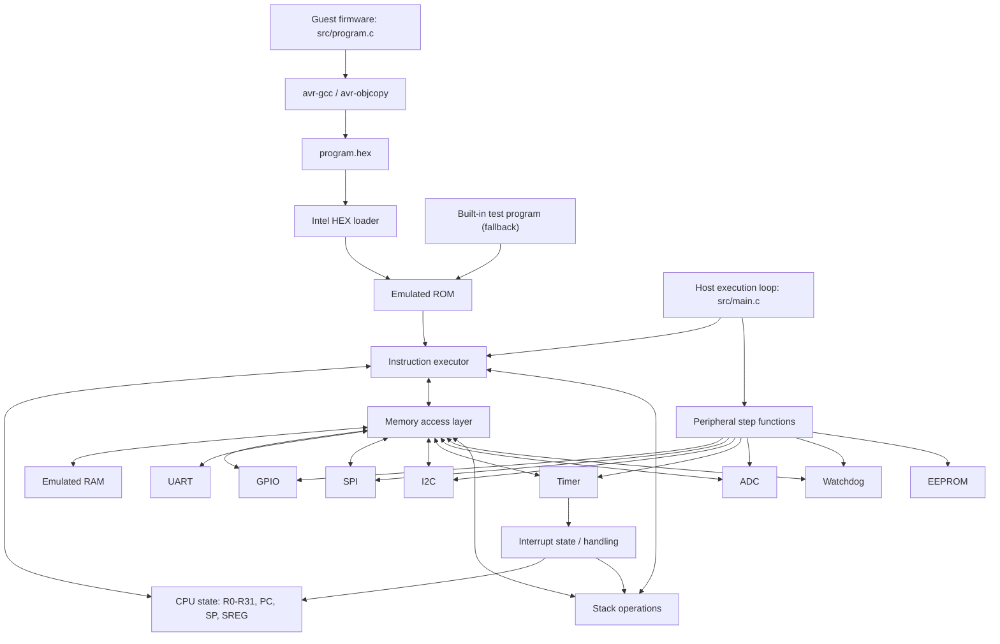

# AVR Emulator architecture

## Execution flow

1. The host initializes CPU and memory/peripheral state.
2. The loader copies the compiled guest program from `program.hex` into emulated ROM. If loading fails, a built-in program is used.
3. The host repeatedly executes one instruction and advances the simulated peripherals.
4. Memory reads/writes dispatch selected register addresses to peripheral models; other valid addresses use emulated RAM.
5. Pending enabled interrupts transfer control to a configured vector and use the stack for the return address. `RETI` restores execution state.
6. The demonstration ends after 1,000 instruction steps.

This diagram shows the project's software organization, not exact AVR hardware timing or a complete ATmega328P bus model.
